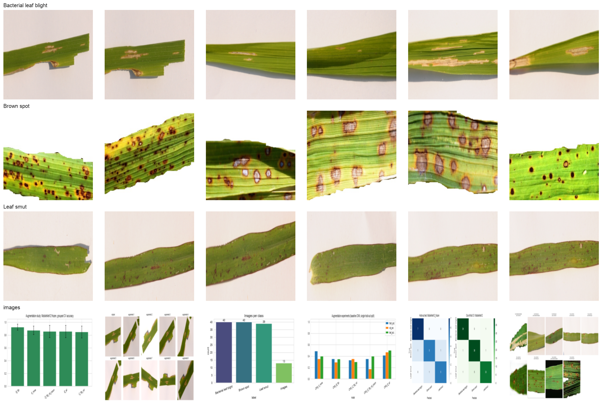
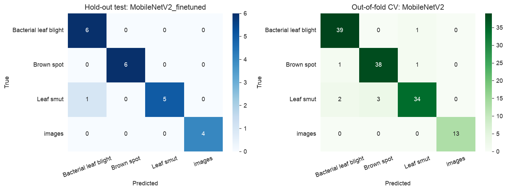

# Rice leaf disease detection (PRCP-1001)

This project classifies photos of rice leaves into three diseases: bacterial leaf blight, brown spot and leaf smut. The dataset is tiny (119 photos), so a good part of the work is about evaluating honestly. I used grouped cross-validation, checked whether the model could cheat using image size or background, and looked at Grad-CAM maps.

Everything is in one notebook, `PRCP-1001-RiceLeaf_final.ipynb`, written in TensorFlow/Keras. scikit-learn is only used for splitting and metrics.



## Data

119 JPG photos, one folder per class: 40 bacterial leaf blight, 40 brown spot and 39 leaf smut (the brief says 40 each, so one leaf smut image is missing from my copy). The photos vary a lot in size, from 250 px wide up to 3081 x 897.

Download: https://d3ilbtxij3aepc.cloudfront.net/projects/CDS-Capstone-Projects/PRCP-1001-RiceLeaf.zip

## What I ended up with

The final model is MobileNetV2 with ImageNet weights, the backbone frozen and a small head on top, flip augmentation, 224 x 224 input.

- 5-fold grouped cross-validation: **92.4% accuracy (+/- 4.7), macro F1 0.922**
- Out-of-fold predictions over all 119 images: 9 wrong
- Single hold-out test split: 85%, but that is only 20 images, so one photo is 5 points. I trust the cross-validated number more.

| Class                 | Precision | Recall | F1    |
| --------------------- | --------- | ------ | ----- |
| Bacterial leaf blight | 0.951     | 0.975  | 0.963 |
| Brown spot            | 0.884     | 0.950  | 0.916 |
| Leaf smut             | 0.943     | 0.846  | 0.892 |

Backbone comparison, same cross-validation:

| Backbone       | CV accuracy   | Parameters |
| -------------- | ------------- | ---------- |
| MobileNetV2    | 92.4% +/- 4.7 | 2.3M       |
| ResNet50       | 89.0% +/- 5.8 | 23.6M      |
| EfficientNetB0 | 87.4% +/- 3.2 | 4.0M       |

The gaps between backbones are about as big as the spread between folds, so I would not say MobileNetV2 is clearly the best, only that it is at least as good and much smaller.



Things I tried that did not help: rotation, zoom and colour augmentation (flip alone was best), fine-tuning the backbone, and a wider input or letterboxing instead of squashing the photos to a square. A CNN trained from scratch only reached 30 to 50% on the test split.

## Things to be careful about

- Image size and background colour carry part of the label. A random forest using only those gets 49 to 59% (chance is 33%). Grad-CAM shows the model mostly looks at the leaf, but I would expect lower accuracy on photos from another camera or background.
- Some photos are of the same leaf. I grouped near-duplicates using image embeddings so they stay in the same split. I only checked the eight most similar pairs by eye, so a few may still slip through and the scores could be slightly optimistic.
- Six of the nine cross-validation mistakes are leaf smut photos, mostly predicted as brown spot. A few of them look unusual to me, possibly atypical or mislabelled, but I cannot tell which.
- There is no healthy-leaf class, so a healthy leaf would still be given one of the three diseases.

More detail is in [REPORT.md](REPORT.md) and in the notebook itself, which has a write-up in every section.

## How to run

```bash
python -m venv .venv
source .venv/bin/activate            # on Windows: .venv\Scripts\activate
pip install -r requirements.txt
jupyter lab PRCP-1001-RiceLeaf.ipynb
```

Put the three class folders (`Bacterial leaf blight`, `Brown spot`, `Leaf smut`) next to the notebook. If they are missing the notebook downloads the zip itself. The first run also downloads the ImageNet weights, so it needs internet.

A full run on CPU takes well over an hour, mostly the cross-validation and the ResNet50 / EfficientNetB0 runs. Set `FAST_MODE = True` in the first cell to get a quicker run that skips the slowest parts.

The notebook was run with Python 3.11, TensorFlow 2.20 and Keras 3.15 on CPU.

## Predicting on new photos

After the notebook has run it leaves `rice_leaf_production_model.keras` (trained on all 119 images) and `model_config.json` in the folder.

```bash
python predict.py leaf.jpg
python predict.py some_folder/ --json
```

Use photos that look like the training data: one leaf on a plain background.

## Files

```
PRCP-1001-RiceLeaf_final.ipynb   the whole project, with write-up and outputs
REPORT.md                        findings and challenges in one place
predict.py                       command-line prediction
requirements.txt
images/                          figures used in the docs
```

The notebook also writes the two `.keras` models, `model_config.json` and a few CSV files with the results.

## Author

Badal Singh Dashmer (https://github.com/badal-10tech)
