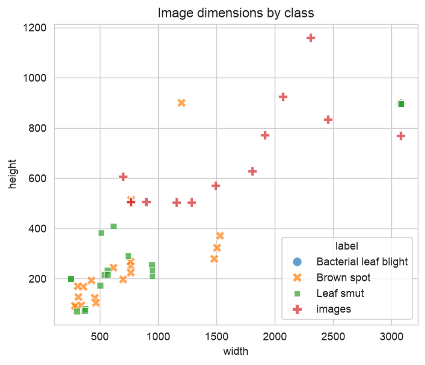
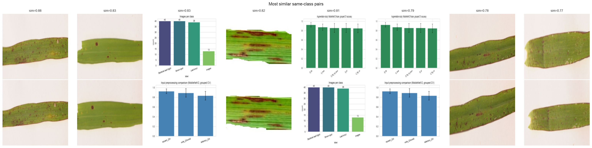
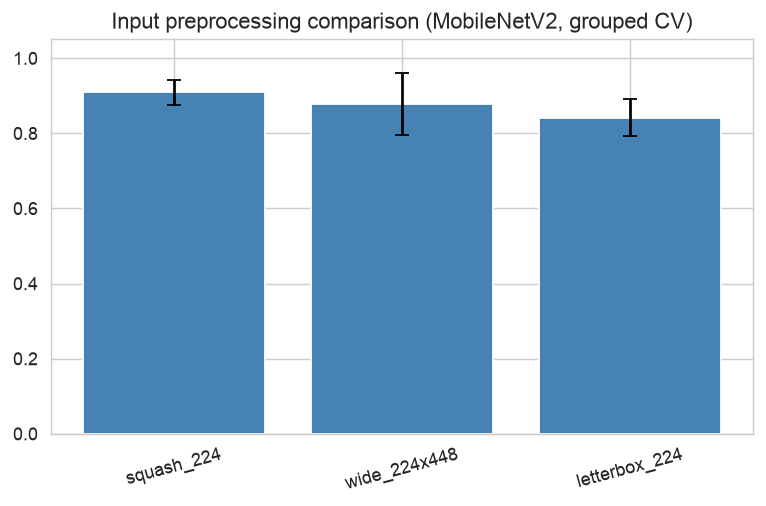
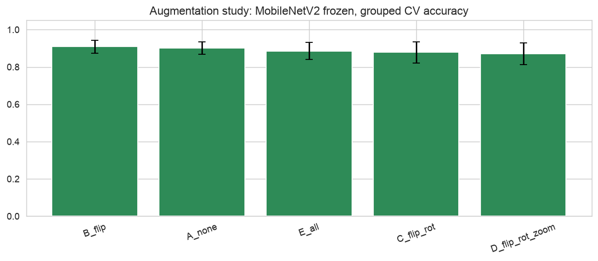
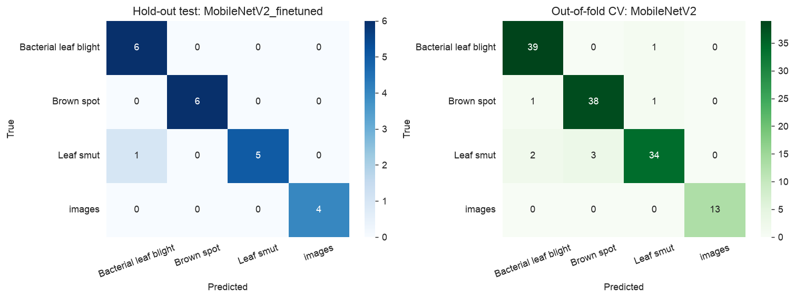
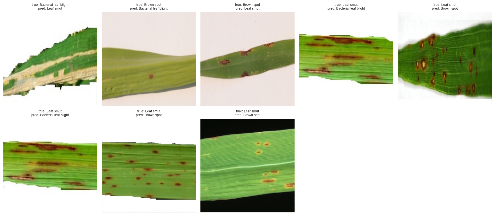
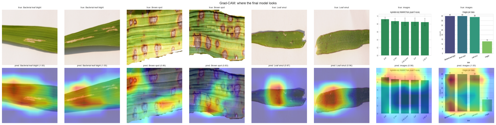

# PRCP-1001 Rice leaf disease detection: report

This covers the deliverables of the brief: data analysis, the model, the augmentation analysis, the model comparison and the challenges. The full workings, code and outputs are in `PRCP-1001-RiceLeaf_final.ipynb`.

## 1. Data analysis

The data is 119 RGB photos: 40 bacterial leaf blight, 40 brown spot and 39 leaf smut. The brief says 40 per class, so one leaf smut photo is missing from my copy. There are no corrupt files and no exact duplicates.

Image sizes vary a lot: widths from 250 to 3081 px and heights from 71 to 900 px, 34 different sizes. More than half are exactly 3081 x 897 (aspect ratio about 3.4 : 1). All 40 bacterial leaf blight photos are that size, while brown spot (23 of 40 wider than 1500 px) and leaf smut (24 of 39) also include many small ones.

Bacterial leaf blight shows long pale streaks along the leaf. Brown spot has dark round spots with a yellow halo, mostly on a white background. Leaf smut has many small dark specks on a green leaf against a pinkish background. Mean RGB is similar for the classes except blue, which is lowest for brown spot (127 against 152 and 141). The colour histograms overlap a lot apart from the background peaks.

The least sharp images are mostly plain green leaves with few spots rather than blurry photos, so I did not remove anything.

### Can a model cheat?

Because size and background differ by class, I trained a random forest on non-leaf features only (5-fold CV, chance is 33%):

| Features | Accuracy |
|---|---|
| Image size, aspect ratio, file size | 58.0% +/- 10.2 |
| Background corner colour | 48.8% +/- 9.2 |
| Both | 58.8% +/- 2.0 |

That is well above chance, so part of the label can be guessed without looking at the disease. The deep models score much higher, but this is a weakness of the dataset.

### Near-duplicate photos

File names are camera numbers, and several photos are clearly the same leaf shot twice. I used MobileNetV2 embeddings to link similar images of the same class (cosine similarity of at least 0.70) and kept each group in one split. That gives 109 groups from 119 images (largest group 3). The nearest same-class image has a mean similarity of 0.54, against 0.32 for the nearest image of another class. The eight most similar pairs (0.88 to 0.74) all look like the same leaf.

My first threshold of 0.80 missed pairs at 0.77 and 0.78 that were clearly the same leaf. I only checked the top eight pairs, so some leakage may remain.

## 2. Approach

* Splits: stratified and grouped. Decisions are made with 5-fold grouped cross-validation. A single hold-out split of 82 / 17 / 20 images is used for the hold-out tables.
* Input: squashed to 224 x 224. I compared that with a wide 224 x 448 input and with letterboxing.
* Models: a CNN from scratch as a baseline, then MobileNetV2, ResNet50 and EfficientNetB0 with ImageNet weights (frozen backbone, global average pooling, dropout 0.3, softmax).
* Final model: MobileNetV2, frozen, flip augmentation. The production version is retrained on all 119 images for 25 epochs.

| Input | CV accuracy |
|---|---|
| Squash to 224 x 224 | **92.4% +/- 4.7** |
| Wide 224 x 448 | 89.0% +/- 8.6 |
| Letterbox 224 x 224 | 83.2% +/- 8.8 |

Letterboxing makes the leaf a thin strip and is clearly worse. Squash against wide (3.4 points) is inside the fold-to-fold spread; in an earlier run with looser grouping the wide input was slightly ahead.

## 3. Augmentation analysis

Five settings: none (A), flip (B), flip + rotation (C), flip + rotation + zoom (D), and all of those plus brightness and contrast (E).

With MobileNetV2 and 5-fold grouped CV:

| Augmentation | CV accuracy | Macro F1 |
|---|---|---|
| B: flip | **92.4% +/- 4.7** | 0.922 |
| A: none | 87.4% +/- 6.6 | 0.870 |
| D: flip + rotation + zoom | 85.6% +/- 9.7 | 0.849 |
| E: all | 85.6% +/- 9.7 | 0.848 |
| C: flip + rotation | 84.8% +/- 9.2 | 0.839 |

Flipping helps by about 5 points. Rotation, zoom and colour changes did not help and were slightly worse than no augmentation, although with a spread of 5 to 10 points between folds I would not read much into the differences between A, C, D and E. Flip being best is more believable since it also won in an earlier run. My guesses (not tested): rotation and zoom produce filled-in corners and distorted lesions on small images, and colour jitter hurts because colour is part of the signal.

The from-scratch CNN got only 30 to 50% test accuracy for all five settings, and its training accuracy stayed at 33 to 49%, so it underfits and cannot say anything about augmentation.

Other techniques: transfer learning instead of training from scratch was the biggest improvement (about 92% against 30 to 50%). Fine-tuning the top 30 layers lowered CV accuracy from 92.4% to 89.9%. Dropout and learning-rate changes on the hold-out split made no difference I could trust.

## 4. Model comparison

| Model | Parameters | CV accuracy | Hold-out test (20 images) |
|---|---|---|---|
| **MobileNetV2, frozen** | 2.26M | **92.4% +/- 4.7** | 85% |
| MobileNetV2, fine-tuned | 2.26M | 89.9% +/- 5.0 | 80% |
| ResNet50, frozen | 23.6M | 89.0% +/- 5.8 | 90% |
| ResNet50, fine-tuned | 23.6M | not run | 90% |
| EfficientNetB0, frozen | 4.05M | 87.4% +/- 3.2 | 75% |
| EfficientNetB0, fine-tuned | 4.05M | not run | 75% |
| CNN from scratch (best of five) | 0.26M | not run | 50% |

Every pretrained model scored 100% on the 17-image validation set, so that split was no use for choosing. ResNet50 looks best on the 20-image test split and MobileNetV2 is best in cross-validation; one image on the test split is 5 points, so I go with cross-validation, which uses all 119 images.

**Recommendation for production: MobileNetV2, frozen backbone, flip augmentation.** It has the best cross-validated accuracy and is the smallest model (about 10 times fewer parameters than ResNet50), which makes it cheap to run on a phone. The accuracy gaps between the three backbones are small compared with the spread between folds, so the size argument is the stronger one.

### Final model results

Out-of-fold predictions (each image predicted by a model that never saw it or its near-duplicates): 92.4% accuracy, 9 of 119 wrong.

| Class | Precision | Recall | F1 |
|---|---|---|---|
| Bacterial leaf blight | 0.951 | 0.975 | 0.963 |
| Brown spot | 0.884 | 0.950 | 0.916 |
| Leaf smut | 0.943 | 0.846 | 0.892 |

On the 20-image hold-out test the accuracy is 85%; brown spot recall is 0.71 there, which is 2 images.

Six of the nine mistakes are leaf smut photos, five of them predicted as brown spot. Several have a background or lighting unlike the typical leaf smut photo and some show spots that look like brown spot to me. I cannot tell whether a few labels are questionable or these are just unusual examples.

Grad-CAM shows the model mostly looking at the leaf, often around the lesions. For leaf smut the highlighted area is broad, and in one example it reaches into the background. So it is mostly the leaf, but this does not rule out background cues.

## 5. Challenges

| Challenge | What I did | Why |
|---|---|---|
| Only 119 images | Pretrained backbones with a frozen base, flip augmentation | A scratch CNN did not learn; a frozen base keeps trainable parameters few |
| Validation and test sets of 17 and 20 images are noisy | Grouped 5-fold cross-validation for every decision | One photo is 5 to 6 points; all models got 100% on validation |
| Photos of the same leaf in different splits | Embedding-based groups and grouped splits | A random split would leak the answer |
| Image size and background reveal part of the label | Measured it with a size/background-only model, checked Grad-CAM | Cannot be removed from this data; stated as a limitation |
| Very wide photos of different sizes | Compared squash, wide and letterbox | Squashing distorts, letterboxing shrinks the leaf; results decided |
| Augmentation and fine-tuning that did not help | Kept the simpler setup | Cross-validated accuracy was equal or worse |
| CPU training time and memory | Kept only weights of trained models, FAST_MODE switch | The notebook ran out of memory when every model was kept |
| Keras refuses an empty Sequential | A do-nothing `Rescaling(1.0)` layer for "no augmentation" | Needed for setting A |
| No data left to validate the production model | Retrain on all images with the CV epoch count | Uses every image; CV is the expected performance |

## 6. Limitations

* 119 photos from one source; real-world accuracy on other cameras, backgrounds or lighting is probably lower than 92%.
* Image size and background carry part of the label.
* The near-duplicate grouping was checked by eye on the top eight pairs only.
* No healthy-leaf class.
* The differences between backbones are inside the fold-to-fold spread.
